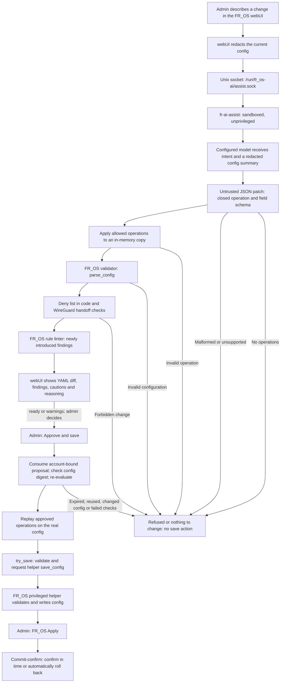
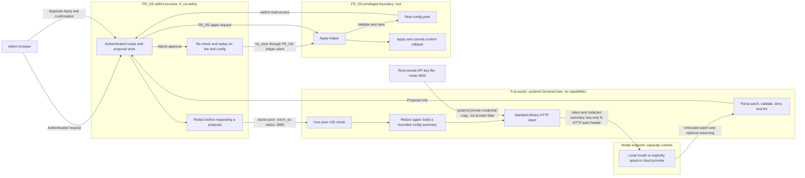

# Architecture and trust boundaries

This document describes the implementation on `main` after the installer
(PR #8).
FR_OS is a pre-existing, pinned dependency; AI-Perimeter adds proposal handling
and an integrated webUI screen. The model proposes data. It has no firewall
execution or save authority.

## From intent to an applied configuration

The diagram follows the executable implementation in
[`pipeline.evaluate`](../src/ai_perimeter/orchestrator/pipeline.py):
**the FR_OS validator runs before the deny list**, even though the module's
introductory sketch and the README list those checks in the opposite order.
The diff is computed on the patched copy before those checks, then returned
with the verdict for display. A displayed diff is not permission to save.

The closed schema in [`ops.py`](../src/ai_perimeter/orchestrator/ops.py)
permits rule changes, app blocking, the ZTNA switch/session duration and
WireGuard peer operations. It does not accept arbitrary commands.
[`deny.py`](../src/ai_perimeter/orchestrator/deny.py) checks the resulting
configuration, including internet-to-router accept rules and changes outside
the permitted sections. The linter compares before and after with empty hit
statistics; this is a configuration review, not a live traffic measurement.

[`routes.py`](../src/ai_perimeter/webui/routes.py) treats the service response
as untrusted too. It parses the operations again, displays strings with
autoescaping, and keeps savable proposals in webUI memory. Each proposal is
bound to the requesting account and a digest of the configuration, expires
after 15 minutes, and can be taken only once. Saving re-evaluates the proposal
and replays its operations on the real configuration so retained secrets are
not replaced by the redacted values. A stale or expired proposal must be
requested again.

Saving and applying are separate actions. The AI-Perimeter save route calls
FR_OS's `try_save`; FR_OS's Apply performs the subsequent load with
commit-confirm rollback. A new WireGuard peer is a handoff to the VPN screen,
which completes device creation and key handling.

## Process and data boundaries

- **webUI:** the unprivileged `fr_os-webui` account can read the real router
  configuration and contact the privileged helper through FR_OS's existing
  protocol. Admin POSTs propose and save; a viewer can see service status.
  See the [route module](../src/ai_perimeter/webui/routes.py) and pinned
  [FR_OS account/path definitions](https://github.com/starsmash29/fr_os-hackathon/blob/815576493ca8c6512244bae9b482d6923c575650/src/frfw/paths.py).
- **AI service:** [`fr-ai-assist.service`](../systemd/fr-ai-assist.service)
  uses `DynamicUser=yes`, empty capability sets, a read-only system sandbox
  and no webUI supplementary group. Its documented boundary excludes the
  real `config.yaml` and apply-helper access. It can use Unix sockets and
  IPv4/IPv6 to contact the model; it has no raw/netlink socket family.
- **Socket:** [`fr-ai-assist.socket`](../systemd/fr-ai-assist.socket) is
  `root:fr_os-webui`, mode `0660`.
  [`service.allowed_uids`](../src/ai_perimeter/service.py) also checks
  kernel-reported peer credentials: root, the service's own UID (for a
  development run), or the webUI account. Named tasks are `ping`, `status`
  and `propose_patch`; only one model call runs at a time (a second request
  while one runs is refused as busy, not queued).
- **Model endpoint:** the local inference process (llama.cpp or Ollama) is
  separate from the AI service sandbox and is run by the operator; this
  repository ships no unit for it, so its account and sandbox are the
  operator's choice. It should listen on loopback only. A remote provider's
  OS identity is outside this repository's control.
- **Privileged helper:** FR_OS owns configuration writes and Apply. The
  [pinned `try_save` implementation](https://github.com/starsmash29/fr_os-hackathon/blob/815576493ca8c6512244bae9b482d6923c575650/src/frfw/webui/actions.py)
  validates before requesting `save_config`; the helper validates again.
  AI-Perimeter's model service does not call it.

### What enters the model prompt

[`prompt.summarize`](../src/ai_perimeter/orchestrator/prompt.py) supplies
timezone, zone names/descriptions and internet-facing flags, rules, reserved
devices' names/MACs/addresses/zones, app-control state and known app IDs,
ZTNA enabled/session-duration settings, and WireGuard enabled state/peer names.
The admin's intent and this summary are serialized as JSON data.

The prompt does **not** contain password hashes, API keys, the metrics token,
WireGuard keys or peer addresses, or a copy of every configuration section.
Redaction is not anonymization: the included device identifiers and rule
addresses remain visible to the selected provider. Do not put secrets into
the free-text intent.

Provider authentication is a separate boundary: the service reads its key
from a file or a systemd credential and places it in the HTTP Authorization
header, never in the model messages. The cloud provider necessarily receives
that authentication header. [`settings.py`](../src/ai_perimeter/settings.py)
and [`client.py`](../src/ai_perimeter/client.py) define this handling.

### Status and deployment scope

`ready` means the proposal passed the checks without a new warning-level
linter finding; informational findings may still appear. `warnings` is
savable after the admin reviews the warnings. `refused` and `nothing`
are not savable. Service/transport failures are errors, not proposals.

### How it joins FR_OS

No FR_OS file is changed, so FR_OS's own integrity check (which compares the
installed files with the signed release) stays clean. `fr-webui-ai` runs
FR_OS's unchanged webUI code and adds the screen and its sidebar entry in
memory; a systemd drop-in for `fr-webui.service` starts it in place of
`fr-webui`, under FR_OS's own account and sandbox. See
[integration/fr_os/README.md](../integration/fr_os/README.md).
[`installer/install.sh`](../installer/install.sh) installs the package, the
units and the drop-in, and the `install` CI job runs it on a real systemd
next to FR_OS's real `fr-webui.service`. Saving and FR_OS's Apply with
commit-confirm on a full FR_OS router are exercised in the demo environment,
not in CI.
The anomaly explainer (A4) uses the same service with a second task,
`explain_incident`: the webUI builds a pseudonymised evidence bundle from
FR_OS's sensor files, which `fr-webui` may already read (`/etc/fr_os/sensors`,
and the resolver's query log through the `fr_os-feeds` group), and the model
answers in a bounded read-only loop over that bundle. See the README's
"What did the router see?".

Use only [`tests/data/home.yaml`](../tests/data/home.yaml) for demonstrations.
